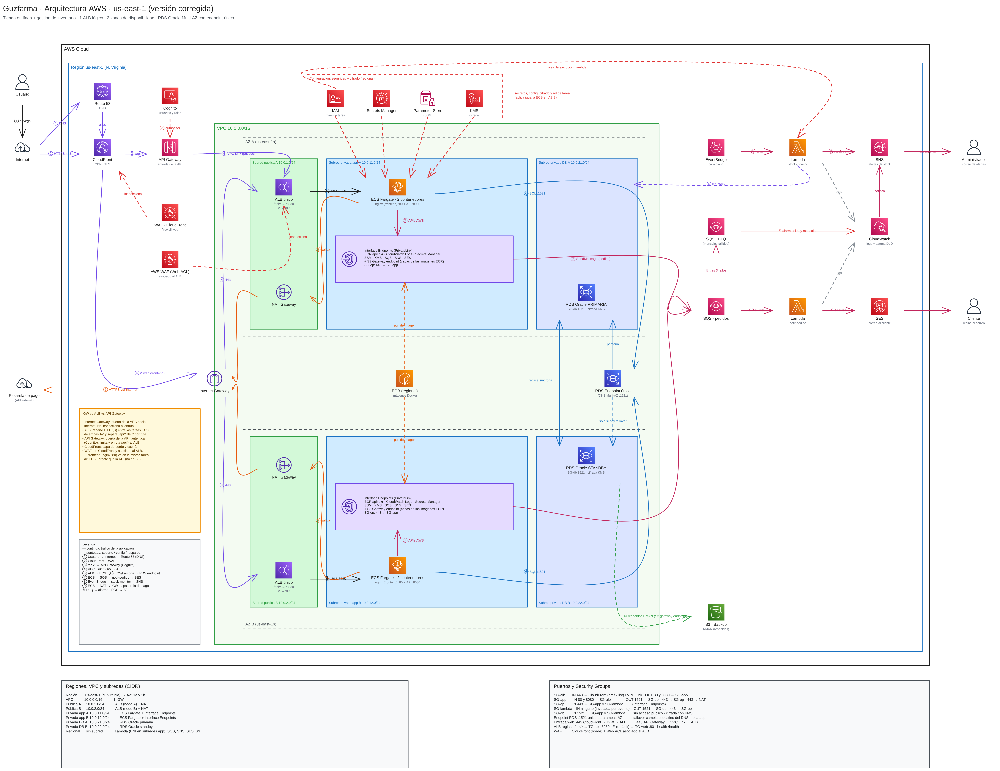

# Guzfarma · Infraestructura como código (Terraform + AWS)

Infraestructura del **Sistema de gestión de inventario y venta en línea de Guzfarma**,
desplegada en AWS (us-east-1, 2 zonas de disponibilidad) y definida con Terraform.



## Arquitectura en resumen

| Capa | Servicios | Módulo |
|---|---|---|
| Red | VPC 10.0.0.0/16, subredes pública / app / db en 2 AZ, IGW, NAT por AZ | `network` |
| Seguridad | Security Groups, KMS, Secrets Manager, Parameter Store, endpoints privados | `security` |
| Datos | RDS Oracle SE2 Multi-AZ (endpoint único :1521), respaldos RMAN en S3 | `database` |
| Eventos | SQS pedidos + DLQ, Lambda notif-pedido + SES, EventBridge + Lambda stock-monitor + SNS | `events` |
| Cómputo | ECR, ALB único, ECS Fargate (nginx :80 + API :8080), Service Auto Scaling | `compute` |
| Borde | Cognito, API Gateway + VPC Link, CloudFront, WAF, Route 53 | `edge` |
| Monitoreo | Alarmas de CloudWatch hacia SNS | `monitoring` |

## Estructura

```
guzfarma-infra/
├── bootstrap/            # bucket S3 del estado remoto (se aplica una sola vez)
├── envs/
│   └── dev/              # entorno dev: une todos los módulos
├── modules/
│   ├── network/
│   ├── security/
│   ├── database/
│   ├── events/
│   ├── compute/
│   ├── edge/
│   └── monitoring/
├── lambdas/              # código Python de notif-pedido y stock-monitor
├── docs/                 # diagrama, división del trabajo, flujo de Git
└── .github/workflows/    # CI: terraform fmt + validate
```

Cada módulo tiene `variables.tf` (entradas), `outputs.tf` (salidas) y `main.tf`
con la lista de recursos que faltan crear y su responsable.

## Requisitos

- Terraform **1.10 o superior**
- AWS CLI configurado (`aws configure` o credenciales de AWS Academy)
- Git y una cuenta de GitHub

## Primeros pasos

```bash
# 1. Estado remoto (solo el Integrante 1, una sola vez)
cd bootstrap
terraform init
terraform apply                 # anota el output tfstate_bucket

# 2. Entorno dev
cd ../envs/dev
cp backend.hcl.example backend.hcl            # poner el bucket del paso 1
cp terraform.tfvars.example terraform.tfvars  # poner los correos
terraform init -backend-config=backend.hcl
terraform plan
```

Para solo revisar sintaxis sin tocar AWS: `terraform init -backend=false && terraform validate`.

## Costos

En `envs/dev` los servicios más caros vienen **apagados** por defecto:
una sola NAT, sin Interface Endpoints y RDS sin Multi-AZ. Para la demo final
se pueden encender en `terraform.tfvars`. **RDS Oracle es lo más caro**: aplicar,
probar, capturar pantallas y hacer `terraform destroy`.

> **AWS Academy Learner Lab:** si la cuenta no permite crear roles IAM, poner el ARN
> de `LabRole` en `lab_role_arn`. Revisen también qué servicios permite su laboratorio
> (por ejemplo CloudFront, WAF o RDS Oracle) antes de aplicar.

## Equipo y trabajo

- [División del trabajo](docs/division-trabajo.md): qué hace cada integrante y en qué orden se integra.
- [Flujo de Git](docs/flujo-git.md): ramas, commits y Pull Requests.

## Estado del avance

| Módulo | Responsable | Estado |
|---|---|---|
| bootstrap | Integrante 1 | Listo |
| network | Integrante 1 | Por hacer |
| security | Integrante 2 | Por hacer |
| database | Integrante 3 | Por hacer |
| events | Integrante 3 | Por hacer |
| compute | Integrante 4 | Por hacer |
| edge | Integrante 5 | Por hacer |
| monitoring | Integrante 1 | Por hacer |
